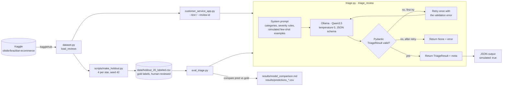

# Architecture (Week 1)

## Triage flow

## Components

| Component | Responsibility |
|---|---|
| `dataset.py` | Fetches the Olist files from Kaggle and caches them; filters reviews down to those with text |
| `triage.py` | The prompt, the `TriageResult` schema, and the model call with validation and one retry |
| `customer_service_app.py` | Command-line entry point that triages one review |
| `scripts/make_holdout.py` | Builds the 20-review held-out set |
| `eval_triage.py` | Runs every model in `MODELS` over the held-out set and writes metrics and the report |
| `tests/` | Offline unit tests for the schema and retry logic (`ollama.chat` is mocked) |

## Output schema

| Field | Type | Allowed values |
|---|---|---|
| `category` | enum | `delivery_delay`, `not_received`, `wrong_or_missing_item`, `damaged_or_defective`, `product_quality`, `seller_or_support`, `billing_or_refund`, `positive_feedback`, `other` |
| `severity` | enum | `low`, `medium`, `high` |
| `sentiment` | enum | `negative`, `neutral`, `positive` |
| `needs_response` | bool | `true` / `false` |
| `summary_en` | string | One English sentence |
